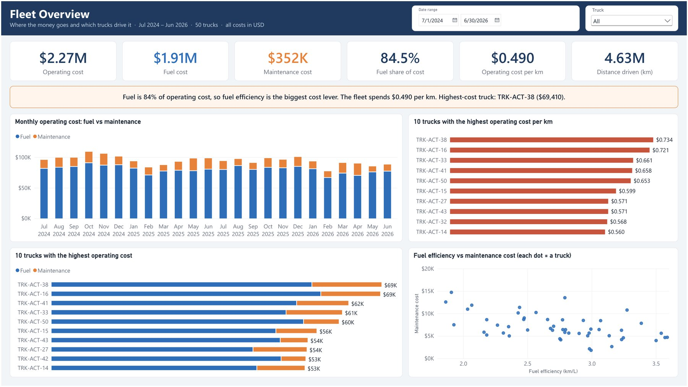
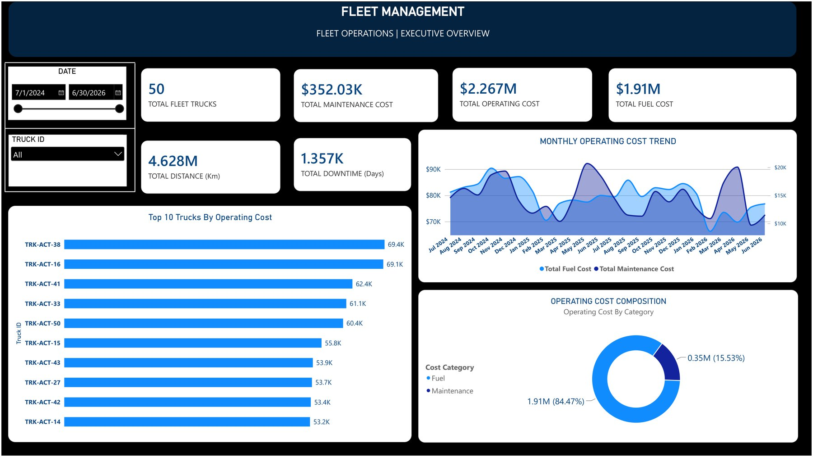
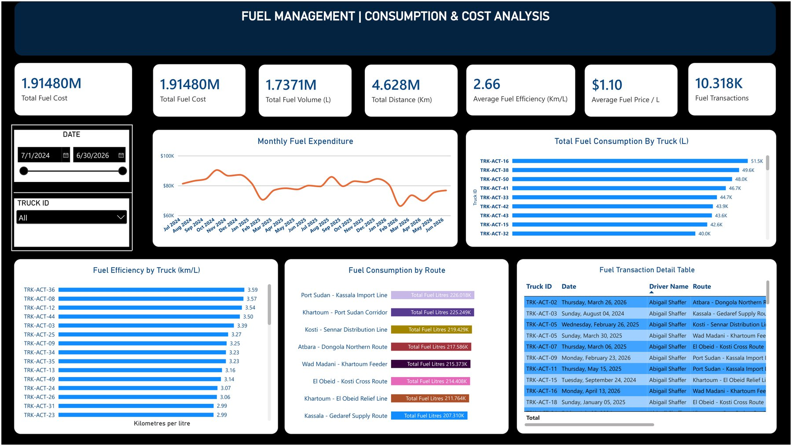
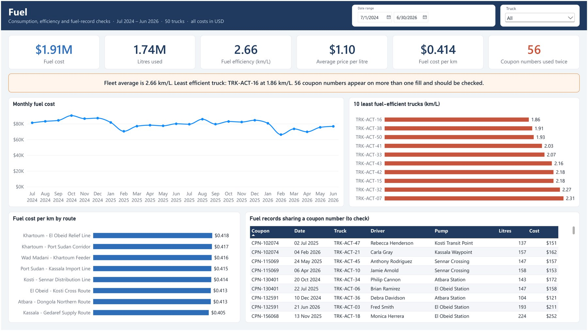
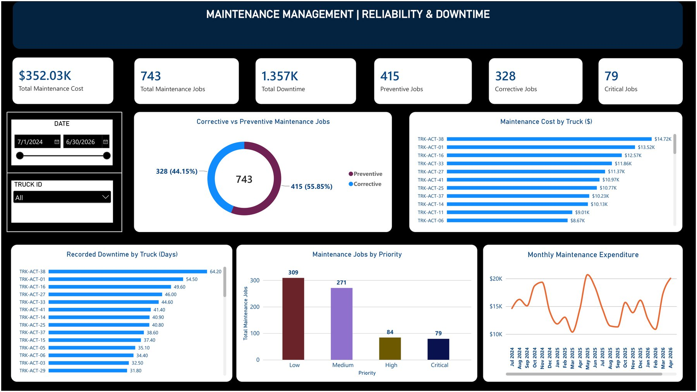
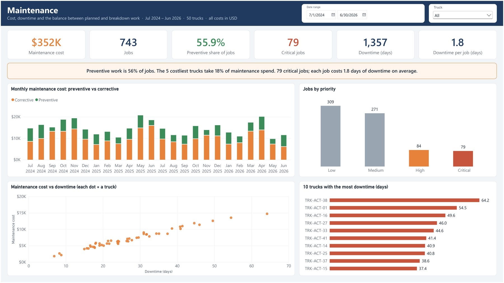
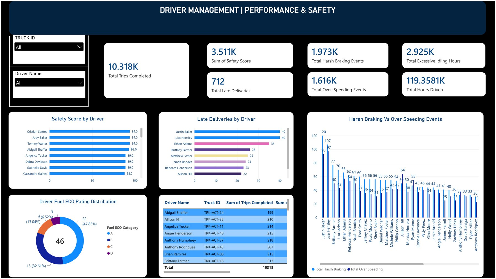
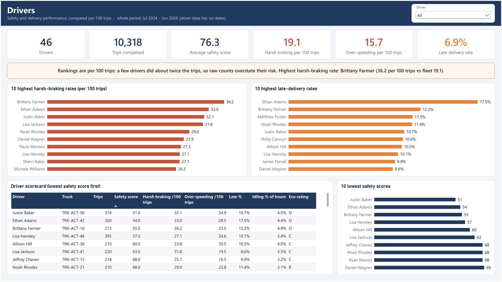
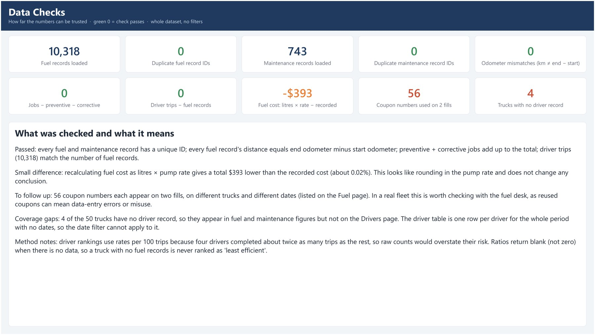

# Fleet Dashboard: Review and Rebuild

A Power BI fleet dashboard that was built for a hiring assessment. I reviewed it, found four calculation problems and a fuel-records issue nobody had flagged, and rebuilt it with a data-checks page and a cleaner design.

The original was built by another analyst and shared with me for review. It is published here with their permission and kept anonymous.

## The data

| | |
|---|---|
| Fleet | 50 trucks |
| Period | July 2024 to June 2026 |
| Fuel records | 10,318 |
| Maintenance jobs | 743 |
| Drivers | 46 (one summary row each, no dates) |
| Operating cost | $2.27M (fuel $1.91M, maintenance $0.35M) |

## What the review found

| # | Problem in the original | Why it mattered | Fix |
|---|---|---|---|
| 1 | The safety-score card added up 46 drivers' scores and showed **3,511** | A sum of scores means nothing to a manager | Average safety score: **76.3** |
| 2 | Driver charts ranked raw counts of harsh braking and late deliveries | Four drivers completed 374 to 395 trips while most did about 200, so they topped every "worst" chart because they drove more | Rates per 100 trips and late-delivery %. The worst harsh-braking rate is Brittany Farmer (36.2 per 100 trips); the worst late-delivery rate is Ethan Adams (17.5%). Lisa Hensley, 2nd on both raw-count charts, drops to 8th on both |
| 3 | Fuel and maintenance cost trends sat on two different axes | Maintenance looked as large as fuel; it is about 15% of operating cost | One stacked chart on one axis |
| 4 | Ratio measures returned **0** when there was no data | A truck with no fuel records could be ranked the "least efficient" | Ratios return blank instead |
| 5 | Not flagged anywhere | **56 fuel coupon numbers are each used on two fills**, on different trucks and different dates | Listed on the Fuel page for follow-up |

Other issues: number formats like `1.91480M` and `119.3581K`, a black background, rainbow colours with no meaning, 50-row scrolling charts, a donut with overlapping labels, and a duplicated KPI card.

## Before and after

| Before | After |
|---|---|
|  |  |
|  |  |
|  |  |
|  |  |
| *(no data checks in the original)* |  |

## Data checks (new page)

Every check is a live DAX measure on the **Data Checks** page.

| Check | Result |
|---|---|
| Duplicate fuel / maintenance record IDs | 0 / 0 |
| Distance = end odometer minus start odometer | 0 mismatches in 10,318 records |
| Preventive + corrective jobs = total jobs | Reconciles (415 + 328 = 743) |
| Driver trips = fuel records | Reconciles (10,318 = 10,318) |
| Fuel cost = litres x pump rate | $393 lower than recorded (0.02%), most likely rounding in the pump rate |
| Coupon numbers used more than once | **56**, to follow up |
| Trucks with no driver record | **4 of 50**, so they don't appear on the Drivers page |

## What changed in the design

- One light theme and one colour per meaning: blue = fuel, orange = maintenance, red = a "worst" ranking, green = preventive work or a check that passed.
- Plain number formats: `$2.27M`, `1,357 days`, `10,318 trips`.
- Date and Truck filters in the page header, kept in sync across pages. The Drivers page says plainly that its data has no dates.
- A one-line insight on every page, written as a DAX measure so it updates with the filters.
- Top and bottom 10 rankings instead of scrolling lists, plus new views: cost per km by truck, fuel efficiency vs maintenance cost, maintenance cost vs downtime, fuel cost per km by route, and a driver scorecard.

## How it was built

I ran the review and the rebuild with an AI agent (Claude) working inside Power BI Desktop through Microsoft's Power BI Modeling MCP server. I set the brief and the standard: no number goes on a page until it has been checked against the data.

- **Every finding was confirmed with DAX queries** against the model, not read off the visuals.
- **Measures and model fixes** were made in the live model and checked the same way.
- **The report pages are code.** `tools/build_report.py` writes all 5 pages (67 visuals) as Power BI's PBIR JSON format, so the layout can be reviewed and changed like any other code.
- **Data files** in `data/` were exported from the model (`tools/export_csv_from_model.ps1`), and a refresh from them reproduces every original total to the cent.

## Repo contents

| Path | What it is |
|---|---|
| `fleet-dashboard-revised.pbix` | The rebuilt report, with data. Opens in Power BI Desktop |
| `pbip/` | The same report as a Power BI project (TMDL model + PBIR report), readable in Git |
| `data/` | The three source CSVs: fuel log, maintenance log, driver performance |
| `docs/review-findings.md` | The full review, page by page |
| `docs/measures.md` | Every DAX measure, grouped by folder |
| `tools/` | The page generator and the CSV export script |
| `images/` | Before and after screenshots |

## Refreshing the data

Open the `.pbix` or `pbip/Fleet Dashboard.pbip`. Then, in Power BI Desktop, go to **Transform data > Edit parameters**, set `DataFolder` to the `data\` folder of your clone (ending with a backslash), and click **Refresh**.
